  

  <strong>Diogo Abreu</strong> aka DAs · Electronics Engineering @ UNIFEI · Brazil 🇧🇷

  
  
  
  
  
  

<strong>Building systems that act — and proving they stay correct.</strong> 
Software engineering · Computer vision · Intelligent systems · Reliable backends

### About me / The engineering behind the aesthetic

I'm an **Electronics Engineering undergraduate at UNIFEI (Brazil)**, interested in the space where software, AI and hardware meet. I enjoy designing ambitious systems, but I care even more about **what happens when they fail**: concurrent writes, invalid model outputs, intermittent connections and surprising real-world behavior.

My undergraduate research explores **multi-object tracking and video compression**; implementation details and research artifacts are kept separate until they are ready to share.

I build to learn. I test to know. I document so somebody else can verify.

### Featured projects / Click the animated emblems

<table>
<tr>
<td width="50%" valign="top">

<strong><a href="https://github.com/DiogoAbreu01/BlueScale">BlueScale</a></strong> 
Constraint-aware event scheduling 
Next.js · PostgreSQL · concurrency · Playwright 
<a href="https://github.com/DiogoAbreu01/BlueScale/blob/main/docs/ENGINEERING_CASE_STUDY_EN.md">Engineering case study</a>
</td>
<td width="50%" valign="top">

<strong><a href="https://github.com/DiogoAbreu01/banco-digital">Aurora</a></strong> 
Transactional banking simulator 
Ruby on Rails · double-entry ledger · MFA 
<a href="https://github.com/DiogoAbreu01/banco-digital/blob/main/docs/ENGINEERING_CASE_STUDY_EN.md">Security & architecture</a>
</td>
</tr>
<tr>
<td width="50%" valign="top">

<strong><a href="https://github.com/DiogoAbreu01/MineLifeIA">MineLife AI</a></strong> 
Memory, autonomy & evidence-based agents 
Python · Fabric/Java · SQLite · local LLM 
<a href="https://github.com/DiogoAbreu01/MineLifeIA/blob/main/docs/ENGINEERING_CASE_STUDY.md">Engineering case study</a>
</td>
<td width="50%" valign="top">

<strong><a href="https://github.com/DiogoAbreu01/CometaPhoenix">Cometa Phoenix</a></strong> 
Midnight JDM racing simulation 
C++17 · SDL2 · OpenGL · CMake 
<a href="https://github.com/DiogoAbreu01/CometaPhoenix/tree/main/docs/screenshots">In-engine screenshots</a>
</td>
</tr>
<tr>
<td width="50%" valign="top">

<strong><a href="https://github.com/DiogoAbreu01/Gato">Gato ☾</a></strong> 
A lunar workspace for university teams 
Next.js · Prisma · Neon PostgreSQL 
<a href="https://gato-atletica-os.onrender.com">Hosted preview</a>
</td>
<td width="50%" valign="top">

<strong><a href="https://github.com/DiogoAbreu01/Luna">Luna</a></strong> 
Where my voice-automation experiments began 
Python · speech recognition · Windows 
<a href="https://github.com/DiogoAbreu01/Luna">Historical prototype</a>
</td>
</tr>
</table>

### Engineering signals

- **Reliability:** BlueScale validates role-based access, conflicting edits and recovery from PostgreSQL serialization failures. Its [synthetic scheduler benchmark](https://github.com/DiogoAbreu01/BlueScale/blob/main/docs/BENCHMARK-SCHEDULER.md) includes reproducible methods and measured data.
- **Correctness before aesthetics:** Aurora implements a fictional **double-entry ledger**, idempotency, security checks and controlled failure-injection tests. Its [engineering case study](https://github.com/DiogoAbreu01/banco-digital/blob/main/docs/ENGINEERING_CASE_STUDY_EN.md) documents the evidence and limitations.
- **Agents that must verify their actions:** MineLife AI separates model suggestions, issued commands and observed in-game results. The project has [automated CI](https://github.com/DiogoAbreu01/MineLifeIA/actions/workflows/ci.yml), but the tests are **not** claimed as proof of long-term autonomous gameplay.

### After the terminal 🌙

Competitive CS2, JDM culture, native racing games, photography, astronomy, learning languages — and the occasional project that begins at 2 AM because I got curious.

**Working toward international remote opportunities in software, computer vision, embedded systems and AI.**

Built in Brazil · DAs · No AI hype without evidence · Always iterating

<!--
  Portfolio visual assets (SVG with SMIL animation and no scripts):
  DAs banner & divider: https://github.com/DiogoAbreu01/Gato/tree/main/assets/portfolio
  Six project icons: /assets/das-animated-icon.svg in each linked public project.
  This file is a ready-to-copy GitHub profile README.
  For it to appear on the user profile, it must be placed as README.md
  in a PUBLIC repository named exactly DiogoAbreu01/DiogoAbreu01.
-->
